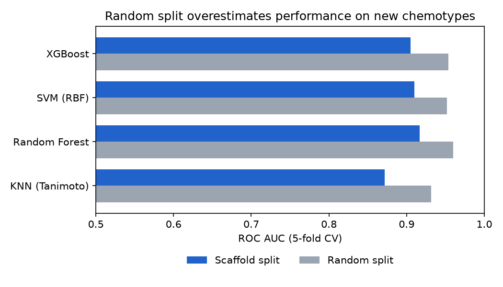
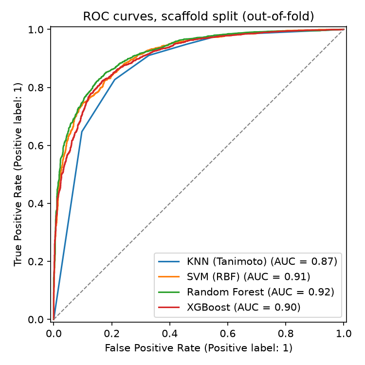

# Alzheimer's Drug Classifier: ML Virtual Screening for AChE Inhibitors

[](https://www.python.org/)
[](https://www.rdkit.org/)
[](https://scikit-learn.org/)

A ligand-based virtual screening model (a QSAR classifier) that predicts whether a molecule
inhibits **human acetylcholinesterase (AChE)**, the target of donepezil and galantamine in
Alzheimer's disease. Molecules are encoded as Morgan fingerprints and four classifiers are
benchmarked on curated ChEMBL bioactivity data.

The main point of the project is **honest validation**. With a random train/test split, close
analogues of the same compound series end up on both sides and the model looks better than it
is. Splitting by chemical scaffold asks the harder, more realistic question: *can the model
recognise actives from chemical families it has never seen?*

Started as an MSc in Bioinformatics project (Universidade da Coruña) and later extended.

## Results

5-fold cross-validation on 4,310 molecules (2,023 scaffolds, 62% active):

| Model | ROC AUC, random split | ROC AUC, **scaffold split** | Balanced accuracy, scaffold | MCC, scaffold |
|---|---|---|---|---|
| **Random Forest** | 0.960 | **0.917 ± 0.022** | 0.835 | 0.66 |
| SVM (RBF) | 0.952 | 0.910 ± 0.024 | 0.823 | 0.64 |
| XGBoost | 0.954 | 0.905 ± 0.021 | 0.821 | 0.64 |
| KNN (Tanimoto) | 0.932 | 0.872 ± 0.022 | 0.791 | 0.61 |



- **Random Forest is the best model** under both splits.
- **Random splitting inflates every model** by 0.04 to 0.06 AUC. The scaffold-split numbers are
  the ones to expect on genuinely new chemistry.
- **Feature selection does not help.** Keeping only the most informative fingerprint bits
  (SelectKBest) never beats using all 1,024 under scaffold CV, so the final model uses all of
  them ([`figures/feature_sweep.png`](figures/feature_sweep.png)).



### Screening reference compounds

The final Random Forest, trained on all curated molecules, scores a few reference compounds.
Before trusting a prediction, the script checks whether the compound is already in the training
data and how similar it is to its nearest training neighbour (Tanimoto similarity).

| Compound | Group | In training set | Max similarity to training | P(active) | Prediction |
|---|---|---|---|---|---|
| Donepezil | known AChE inhibitor | **yes** | 1.00 | 0.98 | active |
| Galantamine | known AChE inhibitor | no | 0.77 | 0.62 | active |
| Demecarium | known AChE inhibitor | no | 0.69 | 0.63 | active |
| Aspirin | negative control | no | 0.47 | 0.27 | inactive |
| Vesatolimod | literature (Vignaux et al.) | no | 0.33 | 0.37 | inactive |
| Serdemetan | literature (Vignaux et al.) | no | 0.38 | 0.27 | inactive |
| Tacrine derivative | literature (Vignaux et al.) | no | 0.57 | 0.46 | inactive |

Donepezil is in the training data, so predicting it correctly proves nothing; the check makes
that explicit. Galantamine and demecarium are recovered as actives without having been seen.
The literature compounds sit far from anything in the training data (similarity 0.33 to 0.57),
outside the region where the model has evidence, so their predictions should be read with
caution.

## Method

**1. Curation** ([`prepare_data.py`](prepare_data.py)). Starting from 9,731 ChEMBL IC50 records
for human AChE (CHEMBL220):

| Step | Records |
|---|---|
| Raw IC50 records | 9,731 |
| Binding assays with a valid value in nM | 8,179 |
| Not flagged by ChEMBL (validity comment or potential duplicate) | 6,837 |
| Unique parent structures (salts stripped, charges neutralised) | 6,099 |
| Final labelled molecules | **4,310** |

- Repeated measurements of the same molecule are collapsed to **one row per structure**, using
  the median IC50. Without this, the same compound can appear in both training and test folds.
- **Active:** median IC50 ≤ 1 µM. **Inactive:** ≥ 10 µM. The grey zone in between (1,789
  molecules) is removed to keep labels unambiguous. Censored values (">10 µM") are used only
  when a molecule has no exact measurement.

**2. Features.** 1,024-bit Morgan fingerprints (radius 2) with RDKit.

**3. Models** ([`evaluate_models.py`](evaluate_models.py)). KNN with Tanimoto (Jaccard)
distance, SVM, Random Forest and XGBoost. Class imbalance is handled with class weights instead
of discarding data. Any feature selection runs inside the pipeline, so it is refitted on each
training fold.

**4. Validation.** Stratified 5-fold CV with a random split, and stratified group 5-fold CV
grouping molecules by **Bemis-Murcko scaffold**, so no scaffold appears in both training and
test folds.

**5. Screening** ([`screen_candidates.py`](screen_candidates.py)). Final model on all data,
plus a training-set lookup and nearest-neighbour similarity for each candidate.

## Limitations

- **Binary labels throw information away.** Regressing pIC50 directly would use the grey-zone
  molecules too.
- **IC50 values come from many labs and assay conditions**, so the same compound can differ by
  an order of magnitude between papers. The median softens this but does not remove it.
- **Scaffold splitting is stricter than random splitting, but still optimistic** compared with
  a time-based split (training on older papers, testing on newer ones).
- **Activity on AChE is not a drug.** The model says nothing about selectivity, blood-brain
  barrier penetration or toxicity.

## How to run

```bash
pip install -r requirements.txt
python prepare_data.py       # curated dataset -> data/ache_dataset_clean.csv
python evaluate_models.py    # CV benchmark -> results/cv_results.csv and figures/
python screen_candidates.py  # reference compounds -> results/screening.csv
```

The whole pipeline runs in about two minutes on a laptop. Random seeds are fixed.

## Repository structure

```
data/chembl_ache_ic50.csv    raw ChEMBL export (human AChE, IC50)
common.py                    paths, standardisation, fingerprints, scaffolds
prepare_data.py              curation and labelling
evaluate_models.py           random vs scaffold cross-validation, feature selection sweep
screen_candidates.py         final model and reference compounds
results/                     metrics and screening tables
figures/                     plots used in this README
```

## Data

Bioactivity data from [ChEMBL](https://www.ebi.ac.uk/chembl/) (target CHEMBL220), licensed
under [CC BY-SA 3.0](https://creativecommons.org/licenses/by-sa/3.0/).

---
Marwan El Saabi · [Portfolio](https://marwansaabi.github.io) · [LinkedIn](https://www.linkedin.com/in/marwansaabi/)
